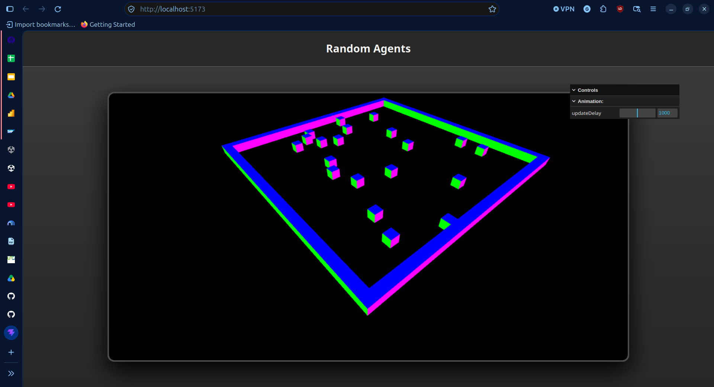

# Agent Visualization using WebGL

This project is a simple demonstration of how to visualize the agents from mesa
using WebGL. The server was ran using the environment provided in the
repository.

The application consists of two servers, one for the mesa model, and one for
the visualization. The mesa model uses flask to serve different endpoints that
are used to obtain information from the mesa simulation. The visualization with
WebGL uses a Vite server to host the client application.

It is primarily used to visualize the **Random Agents** model, but the logic
can be extended to visualize the **Traffic/City** simulation.

---

## Prerequisites

To run this visualization, you need two things running simultaneously:

1.  **The Python Backend:** A Mesa model wrapped in a Flask API.
2.  **The Web Frontend:** The web server using Node/Vite/TypeScript.

---

# Instructions to run the local server and the application

There are three ways to start the complete application:
1. [Locally](#local-startup) Starting the individual servers in local environments (requires installing requirements).
2. [Docker individually](#docker-individually) Starting each server using Docker.
3. [Docker compose](#docker-compose) Start both servers using Docker orchestration.

## Local startup

This method requires installing the required modules and libraries for both the
Python backend and the Node frontend in your local machine. It is recommended
to use environments to ensure the required versions are installed.

### Step 1: Start the Python Backend

You need a simulation running that provides data:

1.  Open a terminal at the root of the repository.
2.  Activate your environment:
    * Windows: `.\.agents\Scripts\Activate`
    * Mac/Linux: `source .agents/bin/activate`
3.  Navigate to the `Backend` folder.
4.  Run the flask server:

```bash
python agents_server.py
```

- The script is listening to port 8585 (http://localhost:8585).
**Double check that your server is launching on that port.**

### Step 2: Running the WebGL application

1. Navigate to the `Backend` folder.
2. Make sure that you installed the dependencies with `npm i`.
3. Run the vite server:

```
npx vite
```

## Docker individually

You can start the backend and frontend separately, using Docker.
This requires having Docker installed: [Docker Desktop](https://www.docker.com/products/docker-desktop/).
Setup instructions: [Docker get started](https://docs.docker.com/get-started/get-docker/).

After you have correctly configured Docker in your computer, you can start the servers.

### Step 1: Start the Python Backend

1. Navigate to the `Backend` folder.
2. Create a Docker image:
    ```bash
    docker build -t tc2008b_backend .
    ```
3. Run the container, connecting the port 8585:
    ```bash
    docker run -p 8585:8585 tc2008b_backend
    ```

### Step 2: Running the WebGL application

1. Navigate to the `Frontend` folder.
2. Create a Docker image:
    ```bash
    docker build -t tc2008b_frontend .
    ```
3. Run the container, connecting the port 5173:
    ```bash
    docker run -p 5173:5173 tc2008b_frontend
    ```

## Docker compose

You need to setup Docker locally.

To launch both the frontend and backend, follow these steps:

1. Navigate to the `BaseProject` folder.
2. Build both images:
    ```bash
    docker compose up --build
    ```
3. Run the whole simulation:
    ```bash
    docker compose up
    ```

# Expected result

- If everything is running, you should acces the webpage:
    `http://localhost:5173/`
- It should render a simple scene with cubes that are moving:


