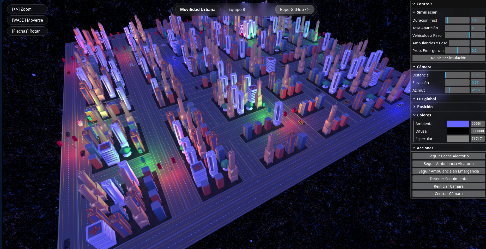

# TC2008B - Multi-Agents and Computer Graphics

Repository with class material for the course TC2008B Multiagent system simulation and computer graphics

By the end of this course, you will create a traffic simulation where each car
is an individual agent traversing a city alongside other autonomous agents.



Sample simulation created by
- Aquiba Yudah Benarroch Bittan
- Diego Córdova Rodríguez
- Lorena Estefanía Chewtat Torres

---

## 📋 Table of Contents

1. [About the Course](#about-the-course)
2. [Repository Structure](#repository-structure)
3. [Prerequisites](#prerequisites)
4. [Installation & Setup](#installation--setup)
5. [References](#references)
6. [License](#license)

---

## About the Course

This repository serves as the central hub for resources, code examples, and
documentation for **TC2008B**. It focuses on the intersection of Multi-Agent
Systems (using Python/Mesa) and Computer Graphics (using WebGL).

## Repository Structure

The repository contains the following material:

* **📂 [Documents](./Documents)**
    Contains presentations, cheat sheets, and theoretical resources.
* **📂 [BaseProject](./BaseProject)**
    A WebGL project used to visualize the random agents model using HTML/JS instead of the standard Mesa visualization.
* **📂 [MultiAgents](./MultiAgents)**
    Basic Mesa examples, including the Random Model, Forest Fire, and the City Model.
* **📂 [Graphics](./Graphics)**
    Basic files for Computer Graphics, using TypeScript and WebGL.
* **📂 [CompetitionSite](./CompetitionSite)**
    Resources regarding the course competition.

---

## Prerequisites

Before setting up the environment, ensure you have the following installed:

* **Python 3.13+**: [Download Python](https://www.python.org/downloads/)
* **Git**: [Download Git](https://git-scm.com/downloads)
* **Node.js**: [Download Node](https://nodejs.org/en/download)

Optional requirements:

* **Conda**: [Download MiniConda](https://www.anaconda.com/download/success?reg=skipped-miniconda)

---

## Installation & Setup

We recommend using a Python virtual environment to manage dependencies. This
keeps your project isolated from other Python projects on your system.

Note: Alternatively you can also install Conda/MiniConda to help you manage
Python environments. See the documentation in [Documents](./Documents).

### 1\. Clone the Repository

```bash
git clone https://github.com/gilecheverria/TC2008B.git
cd TC2008B
````

### 2\. Create the Virtual Environment

Create a virtual environment named `.agents`:

**Windows / macOS / Linux:**

```bash
python -m venv .agents
```

### 3\. Activate the Environment

**Windows (PowerShell):**

```powershell
.\.agents\Scripts\Activate
```

**Windows (Command Prompt):**

```cmd
.\.agents\Scripts\activate.bat
```

**macOS / Linux:**

```bash
source .agents/bin/activate
```

*You will know the environment is active when you see `(.agents)` at the start of your command line.*

### 4\. Install Dependencies

Once the environment is active, install the required packages.

**Option A: Using requirements file (Recommended)**

```bash
pip install -r agents_requirements.txt
```

**Option B: Manual Installation**
If you prefer to install the packages manually, run:

```bash
pip install -U "mesa[all]"
pip install flask flask_cors
```

-----

## References

  * **Mesa**: [Official Documentation](https://mesa.readthedocs.io/en/stable/index.html)
  * **Flask**: [User Guide](https://flask.palletsprojects.com/en/3.0.x/)
  * **WebGL**: [API Documentation](https://developer.mozilla.org/en-US/docs/Web/API/WebGL_API)

-----

## License

This project is licensed under the [MIT License](https://www.google.com/search?q=./LICENSE).

